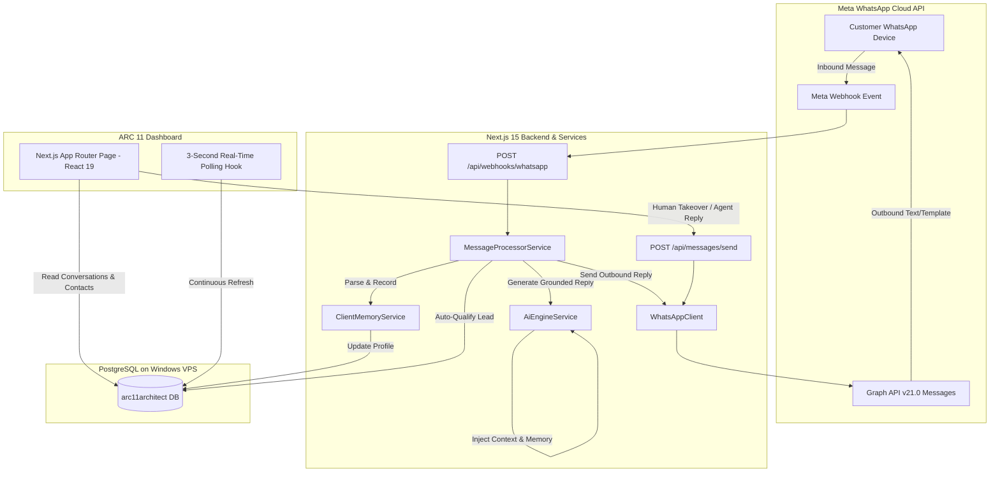

# 01. Architecture Overview & System Design

## 🏛️ High-Level System Architecture



---

## 🛠️ Technology Stack

| Layer | Component | Specification |
| :--- | :--- | :--- |
| **Framework** | Next.js 15.2.0 | App Router, Server Functions, Route Handlers |
| **UI Library** | React 19 | Client Components with Hooks, `lucide-react` |
| **Styling** | Tailwind CSS v4 | Custom architectural warm-neutral theme (`#faf7f2`, `#9b6843`) |
| **ORM** | Prisma 6.4.1 | PostgreSQL client, schema migrations, relation queries |
| **Database** | PostgreSQL 15+ | Hosted on Windows Server VPS (`vps.amcmep.in:5432`) |
| **WhatsApp API** | Meta Cloud API v21.0 | Official WhatsApp Business Account (WABA) |
| **AI / NLP** | Hybrid Architecture | High-Fidelity Rule Engine + OpenAI/Gemini Ready with Persistent Memory |

---

## 📁 Repository Structure

```
arc11-architect-ai/
├── docs/                       # Comprehensive documentation for developer/Codex handover
│   ├── README.md
│   ├── 01-architecture-overview.md
│   ├── 02-database-schema.md
│   ├── 03-meta-whatsapp-integration.md
│   ├── 04-ai-engine-and-client-memory.md
│   ├── 05-api-reference.md
│   └── 06-current-state-and-next-steps.md
├── prisma/
│   ├── schema.prisma           # 25+ Prisma models for WABA, Contacts, Leads, Chat, AI
│   └── seed.ts                 # Database seeder for demo data
├── src/
│   ├── app/
│   │   ├── api/
│   │   │   ├── auth/           # Login / JWT authentication
│   │   │   ├── contacts/       # Client directory API with search & upsert
│   │   │   ├── conversations/  # Conversation listing & details (/id)
│   │   │   ├── faqs/           # FAQ knowledge base management
│   │   │   ├── leads/          # Qualified architectural leads API
│   │   │   ├── messages/send/  # Manual outbound dispatch & simulation endpoint
│   │   │   ├── services/       # Architectural services API
│   │   │   └── webhooks/whatsapp/ # Meta webhook challenge & inbound listener
│   │   ├── layout.tsx          # Root layout with fonts & metadata
│   │   └── page.tsx            # Main architectural dashboard
│   ├── lib/
│   │   └── prisma.ts           # Global singleton Prisma client
│   └── services/
│       ├── ai-engine.ts        # Grounded AI responder with memory injection
│       ├── client-memory.ts    # Preference extraction, memory serialization, auto-leads
│       ├── message-processor.ts# Inbound message orchestrator & state machine
│       └── whatsapp-client.ts  # Meta Graph API HTTP client
├── .env                        # Live database URL, Meta secrets, AI settings
├── package.json
└── tsconfig.json
```

---

## 🔒 Security & Authentication Principles

1. **Meta Webhook Signature Verification:**  
   Incoming webhook payloads are verified against `x-hub-signature-256` using HMAC-SHA256 (`META_APP_SECRET`).
2. **Idempotency:**  
   Every WhatsApp message contains a unique `wamid`. Incoming messages check `prisma.message.findUnique({ where: { wamid } })` before any state transition to prevent duplicate bot replies.
3. **Database Security:**  
   Database credentials use SSL prefer mode connecting to the secure VPS database.
4. **Architectural Safety Rules:**  
   AI never invents prices, fees, municipal approval times, or structural promises. It defers to customized proposals prepared by human partners.
